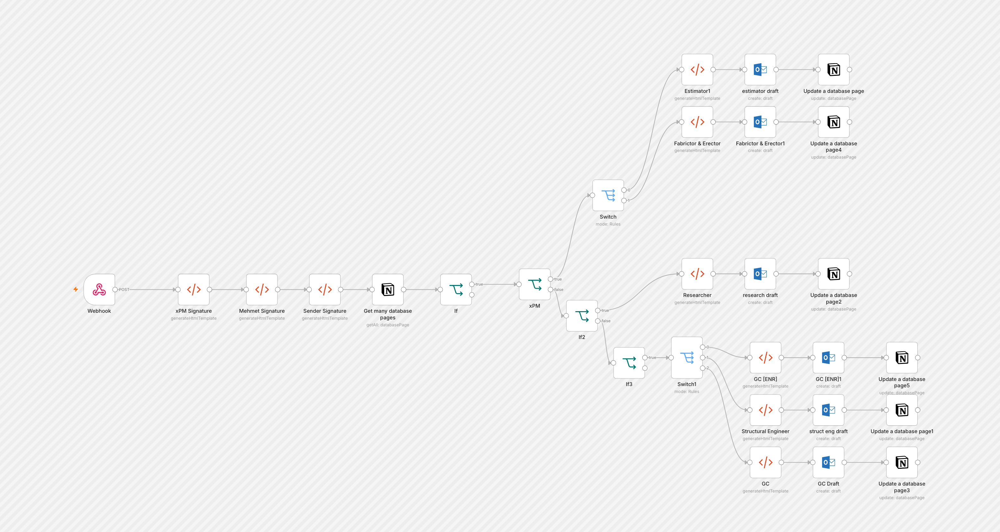

# Role-Based Email Drafter

A Notion webhook sends in contacts. A switch routes each one by role (general contractor, ENR-ranked GC, structural engineer, estimator, fabricator/erector, researcher) to its own HTML email template and the right sender signature. The result is an Outlook draft, and the status is written back to Notion. It creates drafts. It does not send.

Built for construction-industry outreach at xPM.

## At a glance

- Nodes: 29
- Integrations: microsoftOutlook, notion

## Setup

1. In n8n, open **Workflows → Import from File** and select the JSON.
2. Create these credentials and select them on the nodes that need them: `microsoftOutlookOAuth2Api`, `notionApi`.
3. Replace the placeholders below with your own values.

## Placeholders

Values were removed from the export and replaced with:

- `Sender`
- `Sender Name`
- `YOUR_NOTION_ID`
- `name@example.com`
- `your-webhook-path`
